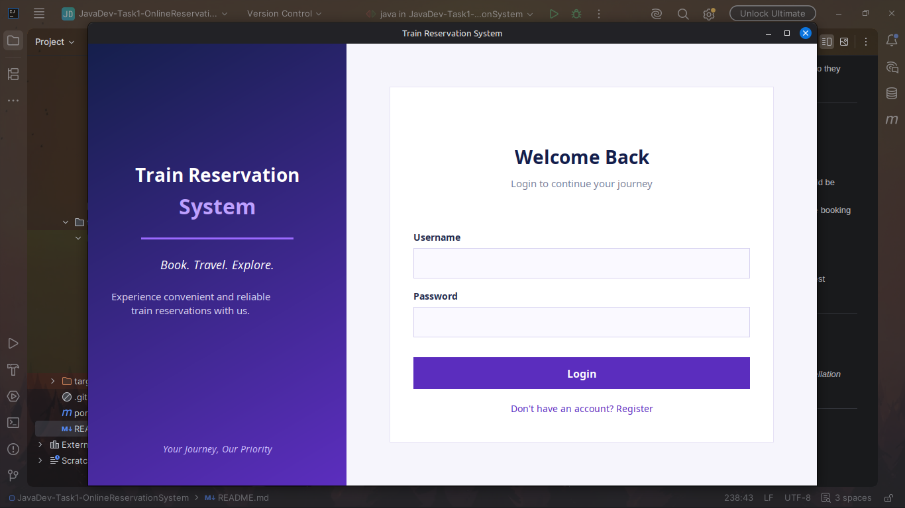
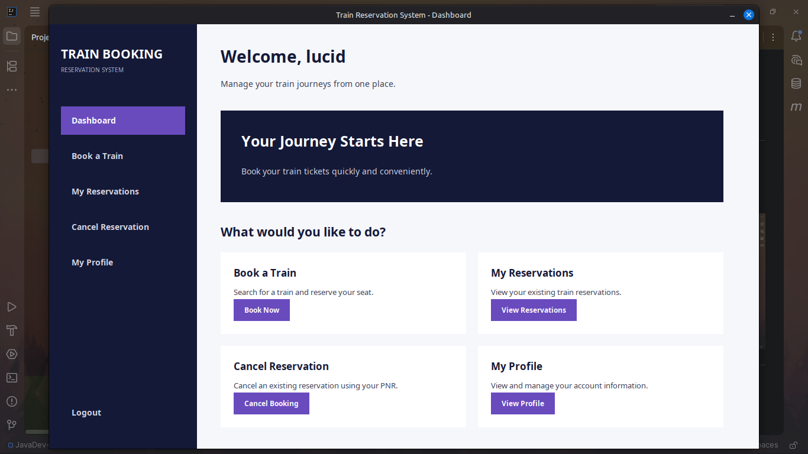
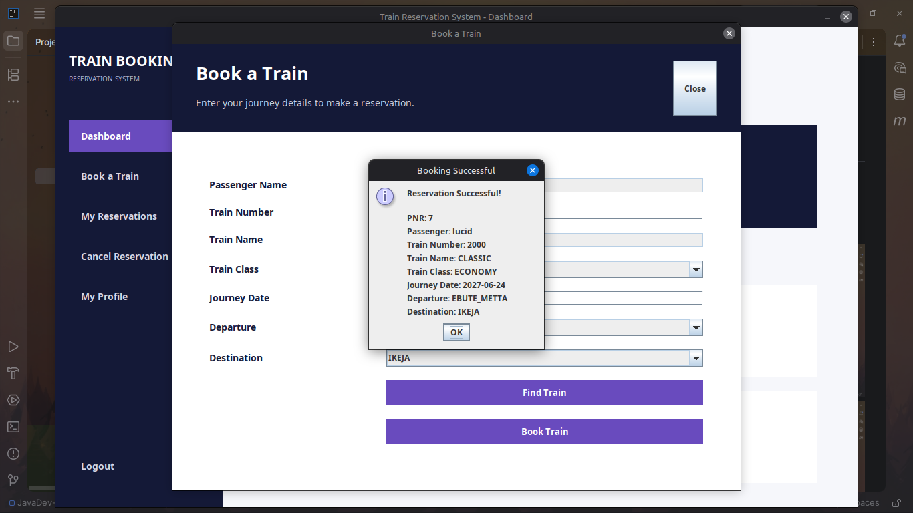
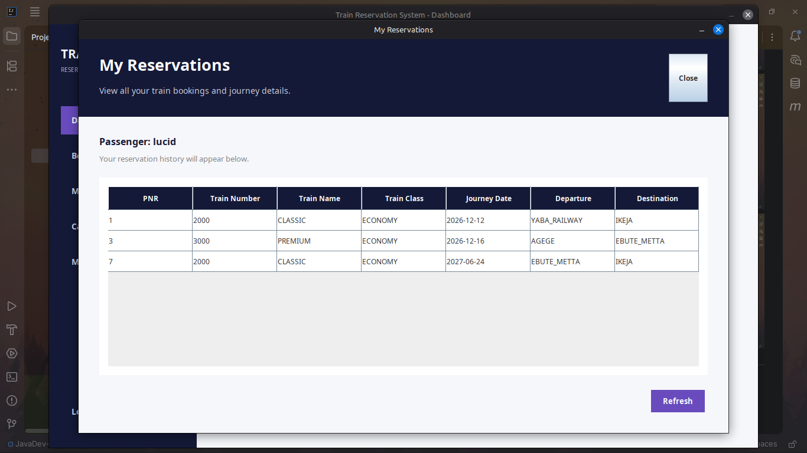
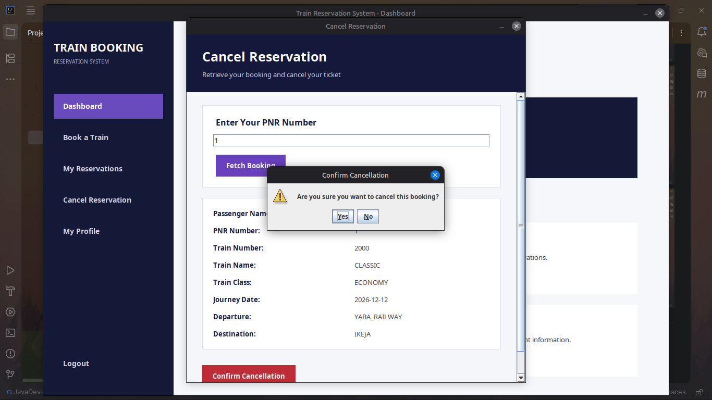

# Online Reservation System

A desktop train reservation application built with **Java Swing**, **JDBC** and **MySQL**. Passengers can register, log in, book train tickets, view their bookings and cancel a booking using its PNR number.

Built as **Task 1 (Java Development)** of the OIBSIP internship programme.

---

## Features

| Feature | Description |
|---|---|
| **Register / Login** | Create an account, then log in with username and password. Invalid credentials are rejected with "Access Denied". |
| **Book a Train** | Enter a train number, and the train name is filled in automatically. Choose a class, journey date, departure and destination. |
| **PNR generation** | Every saved booking gets a unique, auto-generated PNR (the database primary key). |
| **Booking confirmation** | A dialog shows the full booking details, including the PNR, after a successful reservation. |
| **My Reservations** | Lists all bookings made by the logged-in user. |
| **Cancel Reservation** | Enter a PNR, fetch the booking details, then confirm cancellation. An "Are you sure?" dialog appears before the booking is deleted from the database. |
| **Input validation** | Required fields, numeric train number, valid date format, no past dates, and departure must differ from destination. |

Users can only fetch and cancel **their own** bookings.

---

## Tech Stack

- **Language:** Java 21
- **GUI:** Swing
- **Database:** MySQL 8+ via JDBC (`mysql-connector-j` 9.5.0)
- **Build tool:** Maven
- **Libraries:** Lombok (boilerplate reduction)
- **Testing:** JUnit 5 (Jupiter) with hand-written in-memory fakes, no database required

---

## Project Structure

```
src/
├── main/java/com/oibsip/reservation/
│   ├── Reservation.java          # Application entry point (main)
│   ├── views/                    # Swing screens
│   │   ├── LoginFrame            # Login and registration
│   │   ├── HomeFrame             # Dashboard
│   │   ├── ReservationFrame      # Book a train
│   │   ├── MyReservationsFrame   # View bookings
│   │   └── CancelReservationFrame# Fetch by PNR and cancel
│   ├── controllers/              # Pass requests from the UI to services
│   ├── services/                 # Business logic
│   ├── data/
│   │   ├── models/               # Passenger, Reservation, Train, enums
│   │   └── registry/             # JDBC data-access classes (PreparedStatement)
│   ├── database/                 # DataBaseConnection
│   ├── dtos/                     # Request and response objects
│   ├── utils/                    # Mappers and validators
│   └── exceptions/               # Custom error types
└── test/java/com/oibsip/reservation/
    ├── controllers/              # AuthController, ReservationController tests
    ├── services/                 # AuthServiceImpl, ReservationServiceImpl tests
    ├── utils/                    # Mappers tests
    │   └── validators/           # AuthValidation, ReservationValidation tests
    ├── data/models/              # TrainName, models, DTOs and enums tests
    └── testsupport/              # In-memory and failing fake registries, test data
```

The app follows a layered design: **View → Controller → Service → Registry (DAO) → Database**.

---

## Getting Started

### Prerequisites

- JDK **21** (an LTS release; very new JDKs can break Lombok)
- Maven 3.8+
- MySQL Server 8+

Check your versions:

```bash
java -version
mvn -version
mysql --version
```

### 1. Create the database

Log in to MySQL and run:

```sql
CREATE DATABASE online_reservation_system;
USE online_reservation_system;

CREATE TABLE passengers (
    id       INT AUTO_INCREMENT PRIMARY KEY,
    username VARCHAR(50)  NOT NULL UNIQUE,
    password VARCHAR(100) NOT NULL,
    email    VARCHAR(100) NOT NULL UNIQUE
);

CREATE TABLE reservations (
    id                 INT AUTO_INCREMENT PRIMARY KEY,   -- this is the PNR
    passengerName      VARCHAR(50) NOT NULL,
    trainNumber        BIGINT      NOT NULL,
    trainName          VARCHAR(30) NOT NULL,
    classType          VARCHAR(30) NOT NULL,
    dateOfJourney      DATE        NOT NULL,
    sourceStation      VARCHAR(50) NOT NULL,
    destinationStation VARCHAR(50) NOT NULL
);
```

### 2. Configure the connection

Open `src/main/java/com/oibsip/reservation/database/DataBaseConnection.java` and set your MySQL details:

```java
private static final String URL = "jdbc:mysql://localhost:3306/online_reservation_system";
private static final String USERNAME = "your_mysql_user";
private static final String PASSWORD = System.getenv("DB_PASSWORD");
```

Then set the environment variable before running, so no password is stored in the code:

```bash
export DB_PASSWORD="your_mysql_password"
```

### 3. Run the application

**From IntelliJ IDEA:** open the project, set the Project SDK to JDK 21, then run the `main` method in `Reservation.java`.

**From the terminal:**

```bash
mvn clean compile
mvn org.codehaus.mojo:exec-maven-plugin:3.5.0:java -Dexec.mainClass=com.oibsip.reservation.Reservation
```

---

## How to Use

1. **Register** a new account from the login screen, then **log in**.
2. On the dashboard, choose **Book a Train**.
   - Enter a train number. The train name fills in automatically.
   - Pick the class, date (`yyyy-MM-dd`), departure and destination.
   - Click book. Note the PNR in the confirmation dialog.
3. Open **My Reservations** to see your bookings.
4. To cancel, open **Cancel Reservation**:
   - Enter the PNR and click **Fetch Booking**.
   - Review the details, click **Confirm Cancellation**, then confirm the dialog.

### Train numbers

| Train | Number range |
|---|---|
| Classic | 1001 – 2000 |
| Premium | 2001 – 3000 |
| Logistics | 3001 – 4000 |

### Available options

- **Classes:** Economy, Business, First Class, VIP
- **Stations:** Ebute Metta, Blue Line Marina, Agege, Ikeja, Oyingbo Red Line, Yaba Railway, Mushin, Oshodi, Mile 2 Blue Line, Agbado

---

## Validation Rules

| Field | Rule |
|---|---|
| Username | At least 3 characters, must be unique |
| Password | 6 to 16 characters |
| Email | Must contain `@`, must be unique |
| Train number | Numeric, within 1001 – 4000 |
| Date of journey | Format `yyyy-MM-dd`, cannot be in the past |
| Stations | Departure and destination cannot be the same |
| PNR | Cannot be empty, must exist, must belong to the logged-in user |

All database queries use `PreparedStatement` to prevent SQL injection.

---

## Testing

The project has a JUnit 5 test suite covering the logic layers. The tests use in-memory fake registries, so **no MySQL server is needed** to run them and your real data is never touched.

### Run the tests

```bash
mvn clean test
```

In IntelliJ, right-click `src/test/java` and choose **Run 'All Tests'**.

> Maven 3.8 ships with an old Surefire plugin that ignores JUnit 5. The `pom.xml` must include `maven-surefire-plugin` version 3.5.4 or newer.

### What is covered

| Area | What is tested |
|---|---|
| `TrainName` | Every range boundary (1001, 2000, 2001, 3000, 3001, 4000), out-of-range numbers, no gaps in 1001 – 4000 |
| `AuthValidation` | All registration rules including boundary lengths, login denial, logout |
| `ReservationValidation` | Past, current and future dates; existing and unknown PNRs |
| `Mappers` | Every request-to-model and model-to-response mapping, including the derived train name and PNR |
| `AuthServiceImpl` | Register, login and logout, duplicate username and email, nothing saved on invalid input |
| `ReservationServiceImpl` | Booking, unique PNRs, fetching, per-passenger listing, cancelling, cancelling twice |
| Controllers | Full flows, validation errors passed through, and database failures wrapped with clear messages |
| Models, DTOs, enums | Equality, getters and the available stations, classes and trains |

### What is not covered

- **Swing screens** (`views/`) need a display, so they are checked by hand.
- **JDBC registry classes** need a live MySQL database, so they would need separate integration tests.

---

## Known Limitations and Future Improvements

- Passwords are currently stored as plain text. They should be hashed (for example with BCrypt) before real use.
- The train number range (1001 – 4000) is enforced in the booking screen but not in the service layer. Adding the check to `ReservationValidation` would protect other callers.
- The **My Profile** screen is not implemented yet.
- Seat availability and payment are not modelled.
- Add integration tests for the registry classes against a test database.

---

## Screenshots

_Login, Dashboard, Booking, My Reservation and Cancellation screens here._

---

## Author

**Princewill Sharon**
OIBSIP Java Development Internship, Task 1